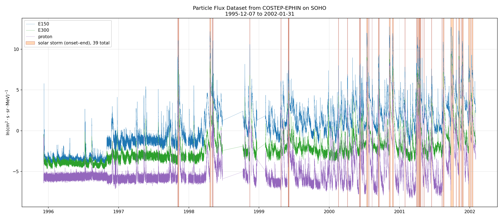
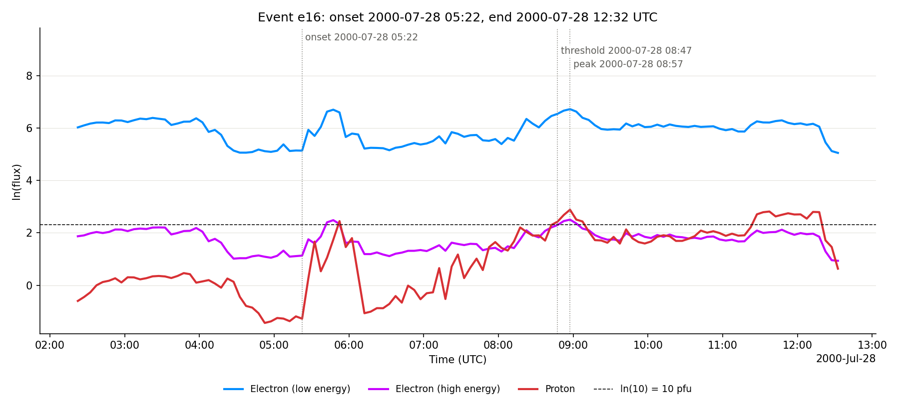
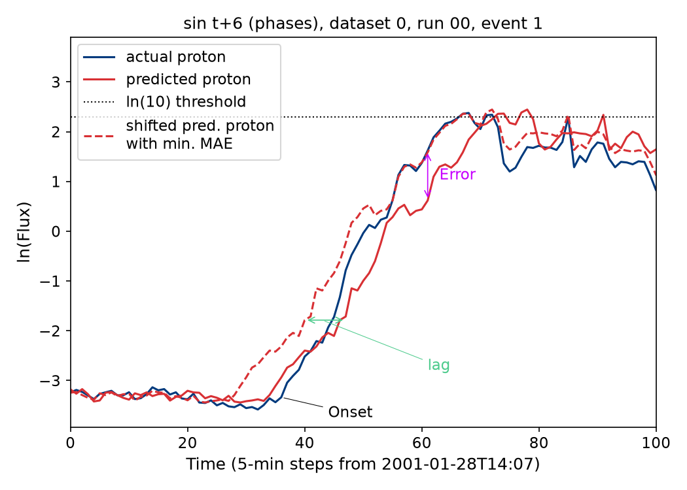
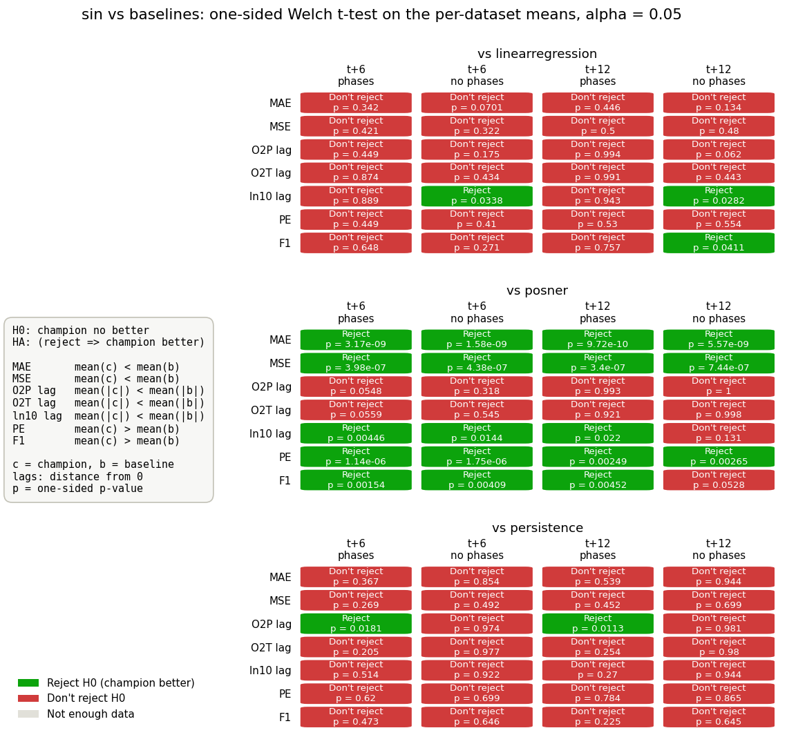
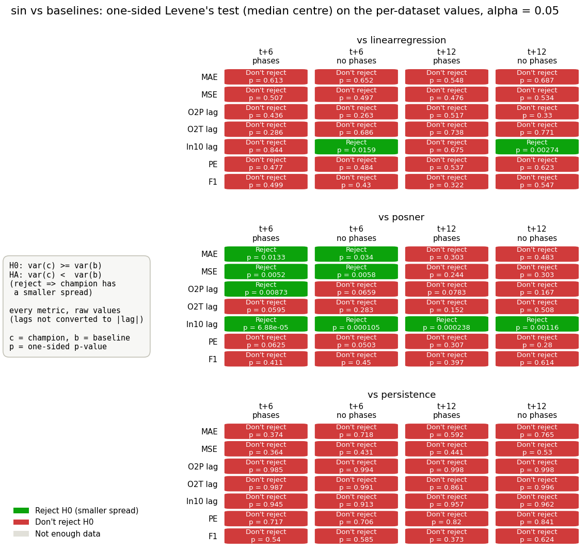
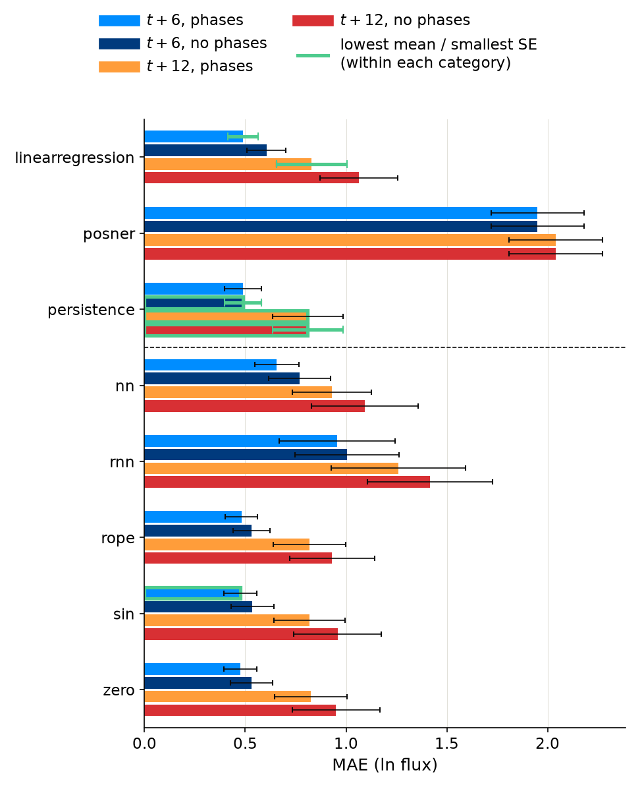
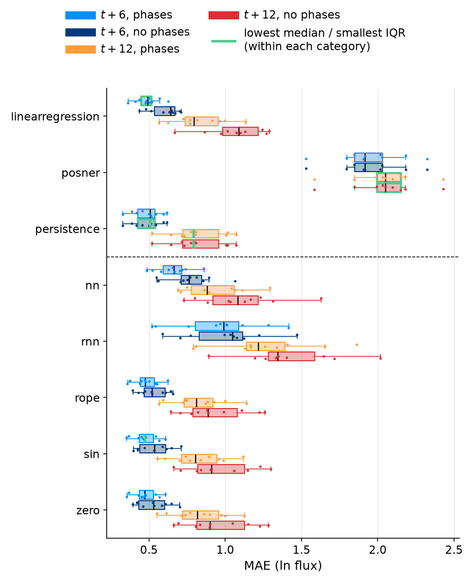
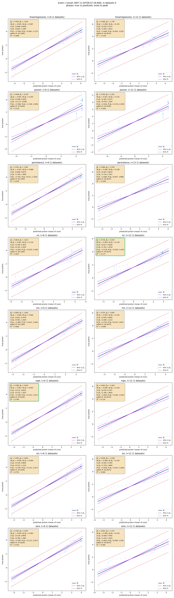

# Comparative Analysis of Proton Flux Forecasting with a Time Series Transformer

## Intro
Predicting Solar Energetic Particle (SEP) fluxes is critical in the protection of operating satellites.  [Posner 2007](https://doi.org/10.1029/2006SW000268) first attempted to demonstrate short term  1 hour forecasting on the Comprehensive Suprathermal and Energetic Particle Analyzer (COSTEP) on SOHO  using relativistic electrons travelling 1 AU ahead of nonrelativistc Solar Proton Events (SPE) using a $13 \times 18$ forecasting matrix that maps electron intensity and a calculated electron increase parameter. Continued efforts using advanced methods such as machine learning algorithms more accurately forecasted these storms. [Torres 2025](https://doi.org/10.1029/2024SW003921) uses Neural Networks (NN) and Recurrnet Neural Networks (RNN) to develope an early warning system using COSTEP data. This repo will attempt to reproduce Torres's M1 models with a transformer encoding only achtiecture using results from both papers as a baseline. Can a transformer achtiecture outperform these models 30 mins to 1 hour while providing accurate forecasting up to 2 hours? 

In [SWLG/SEPTransformerZoo](https://github.com/Lewis-Adkins/SWLG/tree/main/SEPTransformerZoo) we performs a hyperparamterization search to find the most efficient model in forecasting. Torres RNN and NN uses two layers: a hidden layer with 30 units and a dense output layer of one unit. Because of the smaller sizes we will be training our transfomer on smaller parameters.

# Data Acquistion
We retrieve our data from the Solar and Heliospheric Observatory (SOHO) satellite with the Comprehensive Suprathermal and Energetic Particle Analyzer - Electron Proton Helium Instrument COSTEP-EPHIN. SOHO orbits the earth at Lagrange Point 1 (L1) which is consistentyl situated between the sun and the earth around $1.5 \cdot 10^7$ km away from us. This orbit is ideal for its unobstructed view of sun without the risk of earth or our moon pass infront of it. SEPs $>10Mev$ energy levels travel at roughly $43\cdot 10^5$ km/s giving us roughly $.5 \pm 1$ hours to react [Ali](https://arxiv.org/html/2511.04793v1).  Torres uses a the 5 min averaged data for their forecasting. you can download it  [here](https://soho.nascom.nasa.gov/data/archive.html), afterwards you want to extract it in the `SWLG_Code/code/data/enviromental/ephin-soho/5min_proton_1997-2025` folder (need to clean data folder). 

# Config

```yaml
model:
  type: sin         # sin | rope | zero | linearregression | persistence | posner | nn | rnn | tft | chronos2
  n_encoder_layers: 1      
  dim_val: 16              
  dim_feedforward: 64                                
  n_heads: 2               
  dropout: 0.1
  window_size: 25          

training:
  train_new_models : True          
  n_seeds: 10                
  models_in_parallel: 10      
  n_datasets: 10              
  learning_rate: 0.001
  n_epochs: 1
  batch_size: 512
  num_workers: 8
  patience: 20             
  min_delta: 0.0001

evaluate:
  true_vs_pred: True

data:
  prediction_time: [6,12]   
  train_split: 0.8
  use_phases: False  

admin:
  python314_path: ""
  python312_path: ".venv/Scripts/python.exe"   # runs the AutoGluon models (tft, chronos2)   
  data_folder_path: "data"
  results_folder_path: "results"
```

## Configuration Reference

### file
- **find_best_model** — Whether to run model selection across the search results (trivial here since there's one candidate per horizon).
- **model_name_use** — A specific model filename to load by name; empty means none.

### model
- **n_encoder_layers** — Number of stacked transformer encoder layers, set to 2 to match Torres's small scale.
- **dim_values** — The embedding dimension each timestep is projected into before attention, kept small at 32.
- **n_heads** — Number of parallel attention heads (8 dimensions each), letting the model attend to multiple patterns at once.
- **dropout** — Fraction of neurons randomly zeroed during training to limit overfitting, set mild at 0.1.
- **train_new_model** — Whether to train fresh models or skip the search and load prior results; False skips it.
- **seed_experiment** — Whether to retrain the five seeds or evaluate already-saved ones; False evaluates existing models.

### training
- **learning_rates** — Adam's weight-update step size, set to a stable 0.0005.
- **n_epochs** — Maximum training epochs (1000 ceiling), with convergence stopping earlier when loss plateaus.
- **batch_sizes** — Number of windows per gradient update, set to 32 to match Torres-scale training.
- **electron_range** — Input window length in timesteps (24 = 2 hours), matching Torres's electron history window.
- **num_workers** — Parallel CPU processes feeding the GPU, set to 4 for faster data loading.

### data
- **forecasts_out** — Forecast horizons in timesteps: 6 (30 min) and 12 (60 min).
- **train_split** — Fraction used for training versus testing, 0.8 for a chronological 80/20 split.

[Information on editing a Markdown document](https://docs.github.com/en/get-started/writing-on-github/getting-started-with-writing-and-formatting-on-github/basic-writing-and-formatting-syntax)

# Data

## Source

Predicting Solar Energetic Particle (SEP) fluxes is critical in the protection of operating satellites.  [Posner 2007](https://doi.org/10.1029/2006SW000268) first attempted to demonstrate short term  1 hour forecasting on the Comprehensive Suprathermal and Energetic Particle Analyzer (COSTEP) on SOHO  using relativistic electrons travelling 1 AU ahead of nonrelativistc Solar Proton Events (SPE) using a $13 \times 18$ forecasting matrix that maps electron intensity and a calculated electron increase parameter. Continued efforts using advanced methods such as machine learning algorithms more accurately forecasted these storms. [Torres 2025](https://doi.org/10.1029/2024SW003921) uses Neural Networks (NN) and Recurrnet Neural Networks (RNN) to develope an early warning system using COSTEP data. This repo will attempt to reproduce Torres's M1 models with a transformer encoding only achtiecture using results from both papers as a baseline. Can a transformer achtiecture outperform these models 30 mins to 1 hour while providing accurate forecasting up to 2 hours? 

In [SWLG/SEPTransformerZoo](https://github.com/Lewis-Adkins/SWLG/tree/main/SEPTransformerZoo) we performs a hyperparamterization search to find the most efficient model in forecasting. Torres RNN and NN uses two layers: a hidden layer with 30 units and a dense output layer of one unit. Because of the smaller sizes we will be training our transfomer on smaller parameters.

We retrieve our data from the Solar and Heliospheric Observatory (SOHO) satellite with the Comprehensive Suprathermal and Energetic Particle Analyzer - Electron Proton Helium Instrument COSTEP-EPHIN. SOHO orbits the earth at Lagrange Point 1 (L1) which is consistentyl situated between the sun and the earth around $1.5 \cdot 10^7$ km away from us. This orbit is ideal for its unobstructed view of sun without the risk of earth or our moon pass infront of it. SEPs $>10Mev$ energy levels travel at roughly $43\cdot 10^5$ km/s giving us roughly $.5 \pm 1$ hours to react [Ali](https://arxiv.org/html/2511.04793v1).  Torres uses a the 5 min averaged data for their forecasting. you can download it  [here](https://soho.nascom.nasa.gov/data/archive.html), afterwards you want to extract it in the `SWLG_Code/code/data/enviromental/ephin-soho/5min_proton_1997-2025` folder (need to clean data folder). 

## Interpretation

(1-2 paragraphs) Describe what is measured at a basic level. Provide links to 1-2 high-level descriptions (web pages or papers). This should be a text version of your two-minute overview.

We compute mean absolute error (MAE) across all models and their predictions.
We sum all errors at each timestep between the true versus predicted proton flux and
take the mean.
$$
    \text{MAE} = \frac{1}{N}\sum_{i=0}^N |x_{i,{\text{pred}}}-x_{i,{\text{true}}}|
$$
$x_{\text{true}}$  is the true proton,  $x_{\text{pred}}$ is the predicted signal. We measure the lag time of between the predicted and true proton flux. We shift
our predicted protons between the onset and peak of each event align with the true protons and measure MAE at each shift. Once we have the minimum value of MAE we measure the time lag.

For a discrete time series prediction efficieny:
$$
  \text{PE} = 1 - \frac{\sum_{i=0}^N \left(x_{i,\text{pred}} - x_{i,\text{true}} \right)^2}{N \sigma^2_\text{true}} 
$$
$\sigma_{\text{true}}^2$ is the variance in the true signal. PE $<0$ indicates poor predictions where guessing the predicted proton would be more effective.

An F1 score evaluates the performance of our forecasting model.

The score is calculated by arithmetic operations of the number of true positive, false positives, and false negatives the solve into the recall \eqref{recall} and precision \eqref{precision}. the recall and precision values are then used to calculate our final F1 score \eqref{F1}:

$$
\begin{align*}
    \text{recall} &= \frac{TP}{TP + FN}\\
    \text{precision} &= \frac{TP}{TP+FP}\\
    \text{F1} &= \frac{2 \times \text{precision} \times \text{recall}}{\text{precision} + \text{recall}}
\end{align*}
$$

# Exploratory Data Analysis

Provide 1-3 plots that characterize general features of the data. These plots will be revised as you project progresses. 





Example of embedding image in Markdown.


# Statistical Test

## Description

Explain what you want to quantify with statistical methods. Provide references to any equations used.

You can use plain text for equations, e.g., y=mx+b, or LaTeX, e.g., $y=mx+b$.


We want to quantify how much more effective deep nueral networks vs baseline models forecast SEPs.  we perform two tests:
### Welch -T Testing
A Welch -T Test compares the mean performance
of each champion model to baseline model. Neither the population variances are known
making this test the most fitting method (Delacre et al., 2017). e don’t expect base-
line and champion models to have homogenous variances (Welch, 1947).

$$
    \text{t-stat} = \frac{(\bar{x}_{base} - \bar{x}_\text{champ}) - (\mu_{base} - \mu_\text{champ})}{\sqrt{\frac{s_{\text{base}}^2}{n_\text{base}}+\frac{s_{\text{champ}}^2}{n_\text{champ}}}}
$$
The associated alternative hypothesis tests:
$$
\begin{align*}
    H_0 \text{ F1}: \mu_c &\leq \mu_b &&
    H_0 \text{ PE}: \mu_c \leq \mu_b\\
    H_0 \text{ Lag}: |\mu_c| &\geq |\mu_b|&&
    H_0 \text{ MAE}: \mu_c \leq \mu_b
\end{align*}
$$

### Levenes Test
Levenes test asks how does the spread in samples compare from baseline and champion models (Zhou et al., 2023).
$$
\begin{align*}
    H_0&: \sigma_\text{champ}^2 \leq \sigma_\text{base}^2 \\
    z_i &= \left|\hat{\theta}_i^* - \tilde{\theta}^*\right|\\[6pt]
    \bar{z} &= \frac{1}{B}\sum_i^B z_i\\[6pt]
    S_p^2 &= \frac{S_{z,\text{base}}^2 + S_{z,\text{champ}}^2}{2}\\[6pt]
    t &= \frac{\bar{z}_\text{base} - \bar{z}_\text{champ}}{S_p\sqrt{2/B}}, \qquad v = 2B - 2
\end{align*}
$$
## Results







# References

Add references to any web page or paper that you read as you worked on this project.

Example:

* [Wheatland, 2000](https://iopscience.iop.org/article/10.1086/312739/pdf)

# Grading

Final project presentations, 4:30-7:10 pm in the same room as class. [Final Exam Schedule](https://registrar.gmu.edu/fall-2026-final-exam-schedule/)

Project presentations (10-20 minutes)

Guidelines:
1. Present exploratory data analysis results that are relevant to part 2.
2. Discuss question that you want to answer that requires statistical methods. Discuss related literature, if relevant.
3. Review theory
4. Present results related to question

You may use PPT or present from your README.md file.

Grading:
* All revisions discussed during previous class presentations addressed
* Theory correct
* Results correct